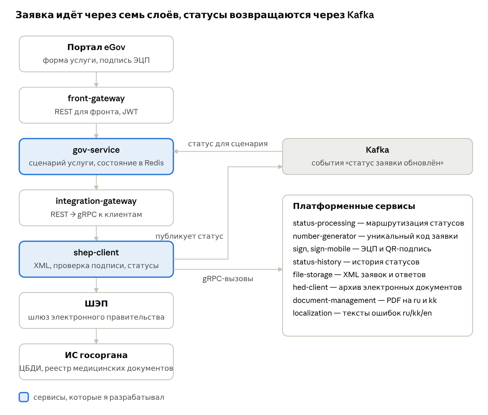

# Hi, I'm Dias 👋

Software Engineer — Java / Kotlin, Spring Boot

1.5 years of commercial backend development on products used by millions of people: **eGov 3.0**, the national e-government portal of Kazakhstan, and **Zvuk**, a music streaming service with 20M+ active users.

---

## 🏛️ eGov 3.0 — what I build

eGov 3.0 is the new version of Kazakhstan's public services portal. Every service is a chain: a citizen fills in a form, signs the request with a digital signature, the request goes to a government agency's information system through the e-government gateway (SOAP), the agency responds, and the citizen gets the result — usually a PDF in their personal account.

The platform is a set of Kotlin / Spring Boot microservices. Synchronous calls between services go over **gRPC** with Protobuf contracts from a shared schema library; application statuses travel asynchronously over **Kafka**. Everything is deployed to **Kubernetes** with Helm and GitLab CI.

The request goes top-down to the agency. The response either comes back in the same call (synchronous gateway channel) or arrives later as a SOAP callback (asynchronous channel). In both cases the client publishes a status to Kafka, and the status router delivers it to the personal account, the status history and the service orchestrator.

### Services I developed from scratch

| Service | Agency and scheme | My part |
| --- | --- | --- |
| Sick leave certificate issuance | Ministry of Health medical document registry, IHE XDS.b (ITI-18 search, ITI-43 retrieve), synchronous | Agency client: signature validation with signer/applicant IIN check, tolerant XML parser for the certificate, status mapping, PDF generation. Orchestrator: document search and selection, process state in Redis, request ownership checks against the JWT |
| Temporary disability certificate | Same registry, synchronous | Base implementation of the "medical document from registry" scheme: gRPC controller, form parser, status model, orchestrator reacting to the SENT event from Kafka |
| Disability status determination | Central disability database, asynchronous with SOAP callback | Agency client: request XML, callback handler mapping agency codes and messages to statuses, batch transfer of agency files to the permanent document archive. Orchestrator: consent flow, "for myself / for a child / for a ward" scenarios with parallel calls to the population registry, family registry and guardianship authorities |

### Engineering notes

- **Process state in Redis instead of pod memory.** The first version kept found documents and the user's choice in memory and did not survive restarts or multiple replicas. Moved it to Redis with a 24h TTL and built access checks on it: foreign request → 403, document outside the found set → 400. Covered with Testcontainers Redis.
- **Signature and XML canonicalization.** The agency rejected signatures when the signed XML was unmarshalled and marshalled back before sending: root name, namespace and prefixes changed and the DigestValue stopped matching. Fix: deserialization is only a schema check; the original signed string goes to the gateway byte for byte.
- **Config clash on the classpath.** After a library upgrade the Spring context failed with an NPE while binding properties. Two libraries shipped `config/application.yml` at the same path; Spring Boot loads only the first, so the second one's defaults disappeared. Found it through property-source ordering, fixed with explicit configuration and documented it for the other teams.
- **Spec vs. test environment.** For one agency the spec described a request format the agency crashed on. On the dev environment I worked out the real format (payload wrapper, root without namespace, one flag that switched the response type), got the first APPROVED and fed the differences back into the spec.

---

## 🎵 Zvuk — music streaming

Podcast backend of one of the largest music streaming services in Russia (20M+ active users): podcast metadata management features in Java and Spring Boot, internal REST APIs between platform services, PostgreSQL schema changes and SQL, API documentation in OpenAPI.

---

## 🛠 Tech stack

- **Languages & frameworks:** Kotlin, Java 17, Spring Boot 3, Spring Security, Kotlin coroutines, WebFlux
- **Contracts & integration:** gRPC, Protobuf, REST, SOAP/XML (JAXB, XSD → classes via xjc), XMLDSig, OpenAPI
- **Messaging & data:** Apache Kafka, PostgreSQL, Redis, Flyway, Elasticsearch
- **Infrastructure:** Docker, Kubernetes, Helm, GitLab CI/CD, Vault
- **Quality:** JUnit 5, MockK, Mockito, Testcontainers (Kafka, Redis, PostgreSQL), SonarQube quality gate

---

## 📫 Contact

